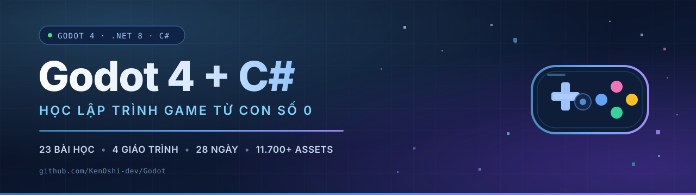

<p align="center">
  
</p>

<p align="center">
  
  
  
  
</p>

<p align="center">
  <b>Lý thuyết đủ sâu · Dự án làm từng bước · Lộ trình 28 ngày · Kèm 34 bộ pixel art</b><br>
  Dành cho người mới bắt đầu, học Godot 4 và C# từ con số 0.
</p>

---

## Giới thiệu

Đây là kho tài liệu **tự học lập trình game 2D bằng Godot 4 + C#**, viết hoàn toàn bằng tiếng Việt. Thay vì đọc rời rạc từng bài, bạn có một hệ thống liền mạch: hiểu ngôn ngữ C#, hiểu engine Godot, rồi áp dụng vào các dự án game hoàn chỉnh.

Triết lý của repo rất đơn giản: **20% đọc, 80% gõ code**. Mỗi chương đều có ví dụ, bài tập, lỗi thường gặp và phần tự kiểm tra để bạn biết mình đã thực sự hiểu hay chưa.

| Nội dung | Số lượng |
| --- | :---: |
| Giáo trình lý thuyết | **4** |
| Tài liệu bài học | **23** |
| Bộ asset pixel art | **34** |
| Tệp asset đi kèm | **11.700+** (~172 MB) |
| Lộ trình gợi ý | **28 ngày** |

### Bạn sẽ học được gì?

- **C# từ nền tảng đến nâng cao**: kiểu dữ liệu, OOP, collection, `null`, delegate/event, `async/await`, bộ nhớ và GC.
- **Godot 4 từ trong ra ngoài**: Node, Scene, Resource, Signal, physics, TileMap, animation, UI, audio, shader, debug và export.
- **Cách C# "nói chuyện" với Godot**: vòng đời node, `[Export]`, signal, `partial class`, `CallDeferred`, đa luồng và tối ưu.
- **Làm game thật**: platformer, top-down RPG và game chiến thuật dàn quân, đi từng bước đến lúc đóng gói.
- **Tư duy kiến trúc**: composition, state machine, event bus, kiểm thử và tổ chức mã nguồn khi dự án lớn dần.

> [!TIP]
> Bạn không cần học hết mọi thứ theo thứ tự. Chọn đúng lộ trình cho mục tiêu của mình ở phần [Bắt đầu nhanh](#bắt-đầu-nhanh).

---

## Nội dung repo có gì?

### 4 giáo trình

| Giáo trình | Nội dung chính | Thời lượng |
| --- | --- | --- |
| [Tài liệu học Godot 4 + C# từ cơ bản đến nâng cao](Courses/T%C3%A0i%20li%E1%BB%87u%20h%E1%BB%8Dc%20Godot%204%20%2B%20C%23%20t%E1%BB%AB%20c%C6%A1%20b%E1%BA%A3n%20%C4%91%E1%BA%BFn%20n%C3%A2ng%20cao%20%284%29.md) | Tài liệu chính: 21 mục tra cứu, phụ lục A–H, 2 dự án mẫu, chuyển GDScript sang C# | Tra cứu lâu dài |
| [Lộ trình học Godot 4 + C#](Courses/L%E1%BB%99%20tr%C3%ACnh%20h%E1%BB%8Dc%20Godot%204%20%2B%20C%23.md) | Chia chặng, lịch 28 ngày, tiêu chí qua chặng, sổ theo dõi tiến độ | 28 ngày |
| [Giáo trình lý thuyết Godot 4 cơ bản](Courses/Gi%C3%A1o%20tr%C3%ACnh%20l%C3%BD%20thuy%E1%BA%BFt%20Godot%204%20c%C6%A1%20b%E1%BA%A3n%20%28h%E1%BB%8Dc%20nhanh%2C%20hi%E1%BB%83u%20s%C3%A2u%29.md) | 19 chương về engine: editor, node/scene, signal, physics, UI, animation, export... | 7–10 ngày |
| [Giáo trình lý thuyết C# trong Godot](Courses/Gi%C3%A1o%20tr%C3%ACnh%20l%C3%BD%20thuy%E1%BA%BFt%20C%23%20trong%20Godot%20%28c%C6%A1%20b%E1%BA%A3n%20%C4%91%E1%BA%BFn%20n%C3%A2ng%20cao%29.md) | 19 chương: ngôn ngữ C#, C# trong Godot, kiến trúc và cổng kiểm tra | 5–7 tuần |

### 23 bài học

| Thư mục | Số bài | Nội dung |
| --- | :---: | --- |
| [`Tutorials/Godot_Basic`](Tutorials/Godot_Basic) | 3 | Làm quen Godot: bản đồ tư duy, cài đặt, project và các loại file |
| [`Tutorials/C%23_Basic`](Tutorials/C%23_Basic) | 20 | C# nền tảng → C# trong Godot → kiến trúc, kèm [cổng kiểm tra](Tutorials/C%23_Basic/question.md) cuối khóa |

Các bài C# được chia theo đúng ba phần của giáo trình:

| Bài | Chủ đề |
| --- | --- |
| [`task_0`](Tutorials/C%23_Basic/task_0.md) | Tổng quan và cách dùng giáo trình |
| [`task_1` – `task_9`](Tutorials/C%23_Basic/task_1.md) | Ngôn ngữ C#: kiểu dữ liệu, luồng điều khiển, hàm, OOP, collection, ngoại lệ, event, async, bộ nhớ |
| [`task_10` – `task_16`](Tutorials/C%23_Basic/task_10.md) | C# trong Godot: Node/Scene, signal, toán & thời gian, input/physics, Resource, đa luồng |
| [`task_17` – `task_18`](Tutorials/C%23_Basic/task_17.md) | Nâng cao: design pattern, cấu trúc mã nguồn, kiểm thử và tooling |
| [`question`](Tutorials/C%23_Basic/question.md) | Cổng kiểm tra trước khi bước vào dự án |

### Lộ trình 28 ngày

| Chặng | Thời gian | Kết quả |
| --- | --- | --- |
| **0. Chuẩn bị** | 0,5–1 ngày | Cài Godot .NET + .NET SDK 8, chạy được game trống |
| **1. Nền tảng** | Ngày 1–4 | Nắm C# cơ bản, Node/Scene và vòng đời node |
| **2. Platformer** | Ngày 5–14 | Hoàn thiện platformer: nhân vật, 2 màn, kẻ địch, HUD, menu, pause |
| **3. Top-down RPG** | Ngày 15–21 | Bản đồ, va chạm, AI, inventory, lưu game |
| **4. Đọc tutorial GDScript** | Ngày 22–23 | Dịch GDScript sang C# mà không bỏ lỡ tài nguyên hay |
| **5. Kiến trúc & xuất bản** | Ngày 24–28 | Tối ưu, kiểm thử, đóng gói game |
| **6. Dự án riêng** | Từ ngày 29 | Game chiến thuật dàn quân, 2D nhìn như 3D |

---

## Cấu trúc thư mục

```text
.
├── Courses/                  # 4 giáo trình lý thuyết dạng dài
├── Tutorials/
│   ├── Godot_Basic/          # 3 bài làm quen engine
│   └── C#_Basic/             # 19 bài C# + cổng kiểm tra
├── Assets/                   # 34 bộ pixel art đã giải nén
├── zip/                      # File nén gốc của các bộ asset
├── docs/
│   └── banner.svg            # Ảnh bìa của repo
├── .gitignore
└── README.md
```

Toàn bộ tài liệu viết bằng Markdown, nên bạn có thể mở thư mục repo trực tiếp bằng [Obsidian](https://obsidian.md) để đọc, liên kết và ghi chú.

---

## Bắt đầu nhanh

### 1. Clone repo

```bash
git clone git@github.com:KenOshi-dev/Godot.git
cd Godot
```

> Chỉ muốn đọc tài liệu? Bạn không cần cài gì thêm — mở thẳng các file trong `Courses/` hoặc `Tutorials/` bằng trình đọc Markdown yêu thích.

### 2. Cài môi trường thực hành

| Thành phần | Ghi chú |
| --- | --- |
| **Godot 4.x bản .NET** | Bản thường không chạy được C#. Tải tại [godotengine.org](https://godotengine.org/download) |
| **.NET SDK 8** | Kiểm tra bằng `dotnet --version` |
| **Rider** hoặc **VS Code + C# Dev Kit** | Rider miễn phí cho sinh viên và dự án phi lợi nhuận |

Sau khi sửa code C#, nhớ **Build** (Ctrl+B trong Godot) thì Inspector mới thấy script và các thuộc tính `[Export]` mới.

### 3. Chọn điểm bắt đầu

| Mục tiêu của bạn | Nên đọc |
| --- | --- |
| Chưa biết gì về Godot | [Giáo trình lý thuyết Godot 4](Courses/Gi%C3%A1o%20tr%C3%ACnh%20l%C3%BD%20thuy%E1%BA%BFt%20Godot%204%20c%C6%A1%20b%E1%BA%A3n%20%28h%E1%BB%8Dc%20nhanh%2C%20hi%E1%BB%83u%20s%C3%A2u%29.md) → [Lộ trình](Courses/L%E1%BB%99%20tr%C3%ACnh%20h%E1%BB%8Dc%20Godot%204%20%2B%20C%23.md) |
| Biết lập trình, muốn nhanh vào game | [Lộ trình 28 ngày](Courses/L%E1%BB%99%20tr%C3%ACnh%20h%E1%BB%8Dc%20Godot%204%20%2B%20C%23.md) → Chặng 0 và 1 |
| Yếu C# hoặc mới học lập trình | [Giáo trình lý thuyết C#](Courses/Gi%C3%A1o%20tr%C3%ACnh%20l%C3%BD%20thuy%E1%BA%BFt%20C%23%20trong%20Godot%20%28c%C6%A1%20b%E1%BA%A3n%20%C4%91%E1%BA%BFn%20n%C3%A2ng%20cao%29.md) → [Tutorials/C#_Basic](Tutorials/C%23_Basic) |
| Cần tra cứu một chủ đề | [Tài liệu chính](Courses/T%C3%A0i%20li%E1%BB%87u%20h%E1%BB%8Dc%20Godot%204%20%2B%20C%23%20t%E1%BB%AB%20c%C6%A1%20b%E1%BA%A3n%20%C4%91%E1%BA%BFn%20n%C3%A2ng%20cao%20%284%29.md) — Phần I, mục 1–21 |

### 4. Tạo project thực hành

Tạo một project Godot .NET tên `Lab`, mỗi chương một scene thử nghiệm. Với phần ngôn ngữ C#, dùng project console cho nhanh:

```bash
dotnet new console -n Lab
cd Lab
dotnet run
```

Đọc 10 phút → tự tay làm 20 phút → đóng tài liệu và giải thích lại bằng lời của mình. Đó là vòng lặp học hiệu quả nhất.

---

## Kho asset

Repo đi kèm **34 bộ pixel art** (~11.700 tệp) đủ để làm một game 2D hoàn chỉnh. Bản giải nén nằm trong `Assets/`, bản nén gốc nằm trong `zip/`.

| Nhóm | Bộ asset tiêu biểu |
| --- | --- |
| **Nhân vật & hoạt ảnh** | Tiny Swords, Sprout Lands, Minifolks Humans, Berie's Adventure, Male Hero, Character Animations |
| **UI & inventory** | Humble Gift Paper UI, Humble Gift Smart UI, Cozy UI Pack, Pocket Inventory, World Map Scroll |
| **Môi trường & bối cảnh** | New Free Backgrounds 1–5, Mondstadt, Garden Cozy Kit, Pixel Art Top Down, Simple Cozy Farm |
| **Hiệu ứng & kẻ địch** | Super Pixel Effects Gigapack, Effect and FX Pixel, Slime Mobs, Mecha-stone Golem |
| **Khác** | Ghostpixxells Pixel Food, file nguồn Aseprite, phụ đề tutorial Godot |

Mỗi bộ asset có file `License.txt`, `license.pdf` hoặc `readme` riêng — hãy đọc trước khi dùng ngoài mục đích học tập.

---

## Ghi chú bản quyền

- **Nội dung giáo trình** được viết và tổng hợp cho mục đích học tập, chia sẻ miễn phí.
- **Asset đồ họa** thuộc bản quyền của các tác giả gốc. Repo chỉ lưu trữ để tiện học theo tài liệu.
- Một số bộ asset yêu cầu ghi công (ví dụ: *Ozzbit Games*, *CraftPix*) hoặc giới hạn dùng cho dự án phi thương mại. Vui lòng kiểm tra license trong từng thư mục trước khi dùng.
- Nếu bạn là tác giả và muốn gỡ một bộ asset, hãy mở issue hoặc liên hệ qua GitHub.

---

## Đóng góp

Mọi đóng góp đều được hoan nghênh:

1. Fork repo và tạo branch mới (`feat/ten-bai-hoc` hoặc `fix/loi-chinh-ta`).
2. Sửa nội dung, thêm bài tập hoặc cập nhật asset.
3. Mở Pull Request, mô tả ngắn gọn thay đổi.

Các đóng góp hữu ích nhất: sửa lỗi chính tả, làm rõ chỗ khó hiểu, thêm ví dụ C# chạy được, và bổ sung link tài nguyên chất lượng.

---

<p align="center">
  Nếu repo này giúp bạn bắt đầu, hãy để lại một ⭐ — đó là động lực để mình viết tiếp.<br><br>
  <b>Made with ❤️ &amp; ☕ · Godot 4 + C#</b>
</p>
